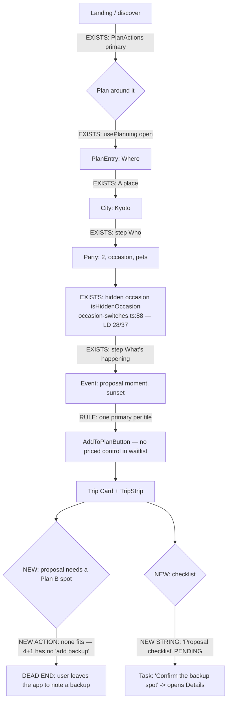
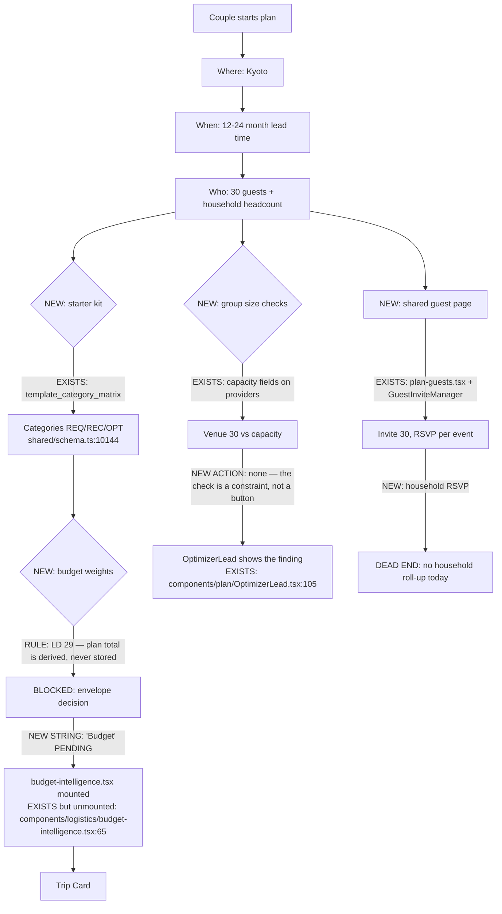
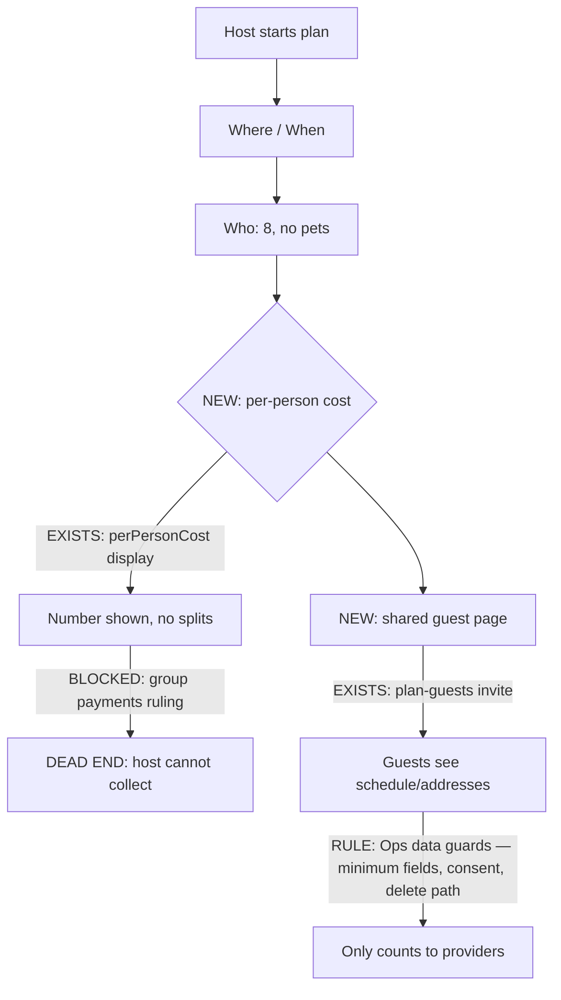
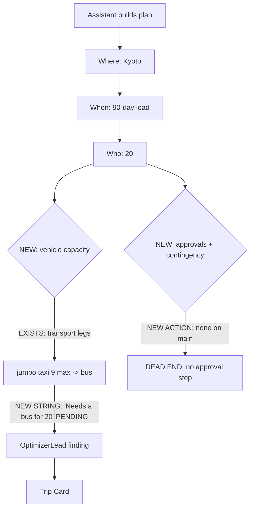
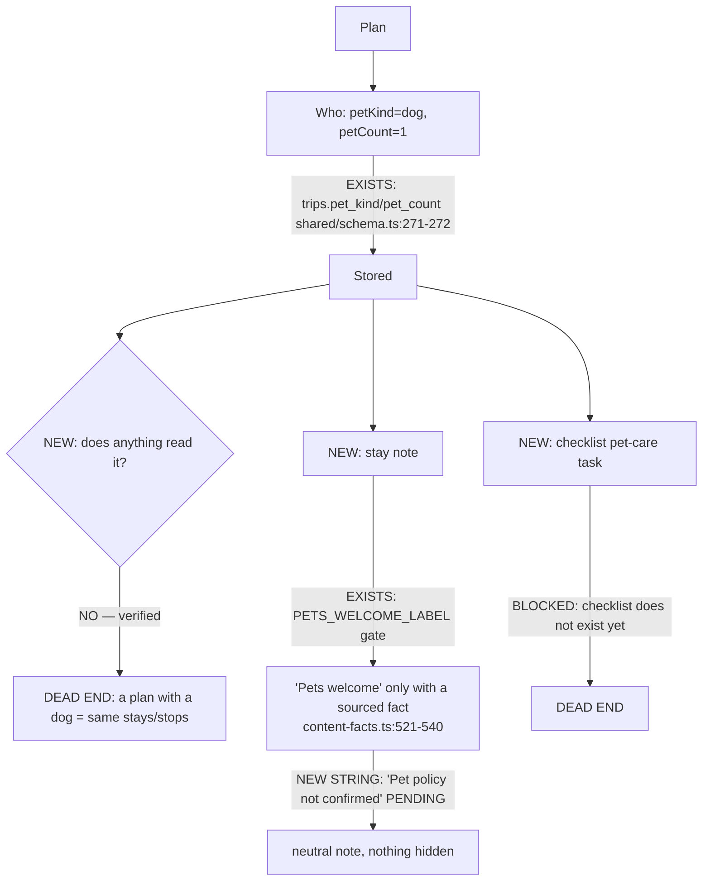

# Occasion tools — user-journey simulation

**Research and design only.** No code, no branches, no PRs, nothing committed. Main read as `b6d73674`.

Method: every `[EXISTS]` below was opened in `client/src`, `shared/` or `server/` on main and is cited by file:line. Nothing is marked `[EXISTS]` on the strength of the brief.

**Two corrections already applied** (found by review, not by me): surprise privacy IS on main as `experience_types.default_visibility` + `isHiddenOccasion()` — my first draft searched for `hideGuest`/`isSurprise` and missed the real name; and the pet columns' migration is `server/migrations/358_trips_pets.sql` (the active set, 452 files), not in `migrations/` (13 Drizzle-only files).

Node markers: `[EXISTS]` · `[NEW ACTION]` · `[NEW STRING]` (PENDING Leon) · `[RULE]` · `[BLOCKED]`.

**The spine, once, for all five personas** (verified):

- `Where` → `When` → `Who` → `What's happening` — `client/src/lib/plan-steps.ts:206-211`
- plan entry offers `A place` / `A date` / `An event` — `client/src/components/plan/PlanEntry.tsx:160-162`
- one primary per tile — `client/src/lib/plan-actions.ts:179-186` (`planActionsPrimary`: Book → Save → Hire → Browse → More info)
- visibility per site/mode — `plan-actions.ts:160` and sites `:121`
- the add — `client/src/components/plan/AddToPlanButton.tsx`
- the 4+1 item menu — `client/src/components/plan/ItemRow.tsx:368-372` (`Details`, `Swap`, `Move up`, `Move down`, `Remove`)
- the only plan chrome — `client/src/components/trip/trip-strip.tsx:72` (`TripStrip`)
- waitlist gate — `client/src/lib/signup-mode.ts:68` (`useBookingActionsShown`)
- capabilities, fail-closed — `client/src/lib/trip-capabilities.ts:21` (`useTripCapabilities`)
- guest list / RSVP — `client/src/pages/plan-guests.tsx:42,76-80` + `client/src/components/GuestInviteManager.tsx`

---

## 1. Flowcharts

### P1 — Kyoto proposal (surprise, occasion hidden)

**Both lanes:** signed out/waitlist, the same nodes run but `Book` and any priced action are suppressed (`plan-actions.ts:160`, `signup-mode.ts:68`); the plan is still mintable and the Trip Card still renders. Signed in with the plan open, a second add is allowed and the 4+1 menu is live.

**The privacy mechanism is real, and it is an OCCASION default.** `experience_types.default_visibility` (`shared/schema.ts:2695` — the column comment names "hidden suppresses Guests/Share/invites (the proposal case)") is read by `isHiddenOccasion()` (`client/src/lib/occasion-switches.ts:88`), and NULL/unrecognised falls back to **shown** (`:84`). LD 28 and LD 37 rule that a hidden occasion has **no guest surface at all**. So a hidden proposal correctly has no Share link and no guest list — the shared guest page simply does not render for it.

**The narrowed gap:** this is a per-occasion-type default, not a per-plan toggle. If the brief promises a traveler can flip "surprise" on one plan, that is genuinely new work; if it only means "the proposal occasion is hidden", main already does it.

### P2 — Kyoto wedding, 30 guests

**Dead end that matters:** the RSVP undercount. `plan-guests.tsx` has per-**event** `{invited, attending}` counts (`:68-72`) but no household grouping, so a couple invited as one household still counts as two rows — the exact failure the research names.

### P3 — birthday trip, 8 friends, each pays their own way

**Dead end that matters:** the money. Billing per person exists only as `perPersonCost` display; there is no split, due or pay-by-date — so an 8-way split is entirely off-app and the host is the human FAQ.

### P4 — 20-person corporate offsite

### P5 — couple bringing a dog

---

## 2. Every action button

| Action | Where it appears | Leads to | Effect on the surface | Personas |
|---|---|---|---|---|
| `Plan around it` `[EXISTS]` `PlanActions` (`plan-actions.ts:160-186`) | tile / detail page | `usePlanning().open` → PlanEntry | new plan, or add if a dated plan exists | P1 P2 P3 P4 P5 |
| `A place` / `A date` / `An event` `[EXISTS]` `PlanEntry.tsx:160-162` | Where step | step advance | asks only what is unknown | all |
| `Add to plan` / `Add to Day {n}` `[EXISTS]` `AddToPlanButton.tsx` | tiles, detail pages, slip | add rail → toast + invalidation | item on the plan, no reload | all |
| `Book` `[EXISTS]` `planActionsPrimary` (`:180`) | tiles, detail pages | booking flow | suppressed in waitlist (`signup-mode.ts:68`) | P2 P3 P4 |
| `Ask AI about this plan` `[EXISTS]` `components/plancard/AskAiDrawer.tsx:123` | Trip Card rail | drawer | none to the plan | P1 P2 P4 |
| 4+1 menu `Details / Swap / Move up / Move down / Remove` `[EXISTS]` `ItemRow.tsx:368-372` | the item row | sheet / reorder | plan order changes | all |
| `Invite` `[EXISTS]` `GuestInviteManager.tsx` | `plan-guests.tsx` | invite row | guest sees the event | P2 P3 |
| `Optimize` `[EXISTS]` `OptimizerLead.tsx:105` | plan surface | optimizer run | findings list | P2 P4 |
| **`Open checklist`** `[NEW ACTION]` — no existing control opens a task list; nothing on main lists tasks by date | plan surface | checklist panel | adds a panel beside the trip card | P1 P2 P4 |
| **`Mark task done`** `[NEW ACTION]` — the 4+1 menu acts on *items*, not tasks; no existing verb fits | checklist row | state change | progress only | P1 P2 P4 |
| **`Add backup spot`** `[NEW ACTION]` — 4+1 has no "add backup"; `Swap` replaces, it does not keep two | item row (Plan B) | second item on same day | plan shows a Plan B | P1 P4 |
| **`Set budget total`** `[NEW ACTION]` — **BLOCKED** on LD 29 | budget panel | envelope | category caps appear | P2 P4 |
| **`Share guest link`** `[NEW ACTION]` — sharing exists as invites, not as a read-only plan link; **suppressed entirely for a hidden occasion** (LD 28/37, `occasion-switches.ts:88`) | plan surface | guest page | third panel | P2 P3 P4 — **never P1** |
| **`Split cost`** `[NEW ACTION]` — **BLOCKED** on group payments | budget panel | dues | per-person amounts | P3 |
| **`Confirm pet policy`** `[NEW ACTION]` — research-side, not traveler-side | stay card | fact row | note only | P5 |

**Count: 6 new actions, 1 new string family, 4 blocked.** No new action is proposed where an existing control already names the intent.

---

## 3. The 10 most important gaps or dead ends, ranked

1. **LD 29 vs the budget envelope (blocking, and absent from the brief).** A category budget panel needs a plan-level total; LD 29 says the total is derived per-event and never stored (`plan-budget.ts`, do-not-touch). Until Leon rules, "the budget panel" cannot be specced — only "the per-event budget, shown better".
2. **Privacy exists only as an OCCASION default, not a per-plan toggle.** `experience_types.default_visibility` (`shared/schema.ts:2695`) + `isHiddenOccasion()` (`occasion-switches.ts:88`) already suppress Guests/Share/invites for a hidden occasion, per LD 28/37. So the brief's §2 row is right — and the remaining question is the one decision 4 must answer: may a traveler hide ONE plan, or only inherit the occasion? Today: inherit only.
3. **The checklist, which item 1 of the proposed order leads with, does not exist at all.** The only checklists are seller-side (`SetupChecklistCard`, `ReadinessChecklist` in `ready-made-listing-panel.tsx:757`).
4. **The budget panel is dead code, not a new build.** `budget-intelligence.tsx` (468 lines, `BudgetCategory { allocated, spent }`, `overBudgetCategories` at `:111`) is exported and mounted on no page — the cheapest win in the whole programme, and the estimate should say so.
5. **Per-person money is display-only.** `perPersonCost` shows a number; there is no split, due or pay-by-date, so P3's 8 friends are entirely off-app.
6. **RSVP has no household roll-up.** `plan-guests.tsx:68-72` counts per event, not per household — the exact undercount the research names.
7. **Pets are stored and never read.** `pet_kind`/`pet_count` (`schema.ts:271-272`) reach only the Who panel; the optimizer, stays and stops are identical with and without a dog.
8. **Weather is off, and Plan B depends on it.** The brief's row says the weather variant was disabled when Grok live search was removed — so a rainy-season Plan B has no engine to sit on yet.
9. **The wedding kit has almost no supply behind it.** No caterers, cake makers, DJs, officiants, stationers or florists in the Kyoto provider set — a starter kit whose line items link to Add will link to nothing for most of a wedding's spend.
10. **The guest page has no privacy model to reuse.** Invites exist (`GuestInviteManager`), and `plan-guests` is owner-gated, but a read-only token page (schedule, addresses, transport, contacts) has no route on main — the closest public routes are `/p/:handle` and `/trip/:id`.

---

## 4. Questions for Leon

1. **LD 29:** may an occasion-level budget envelope exist as an explicit, stored number (an amendment), or does every panel stay event-scoped? *This blocks the budget panel.*
2. **Surprise privacy:** the occasion default already hides Guests/Share/invites (`default_visibility`, LD 28/37). Is that enough, or does a traveler need to hide ONE plan whose occasion type is shown? *The per-plan case is the only new work here, and it blocks the guest page for P1 only.*
3. **Checklist scope:** tasks generated from lead times, or a static per-occasion list? The estimate differs by roughly a factor of three.
4. **Which of the 6 new actions may ship in the first slice** — my recommendation is `Open checklist` + `Mark task done` only, since both reuse Add/Ask for their follow-through.
5. **Pets:** confirm "sourcing now, planning later", and confirm the one new string `Pet policy not confirmed`.
